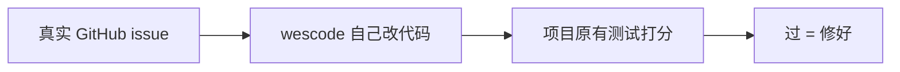
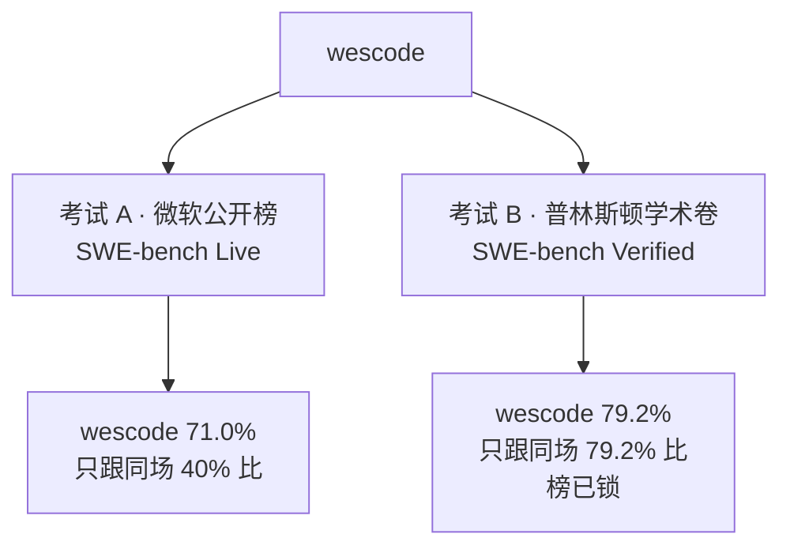

<div align="center">

# wescode 评测

**会自己修真实开源 bug 的编程 Agent**

predictions、评分日志、推理轨迹全部公开，可复现、可核验。

</div>

---

> [!IMPORTANT]
> **71.0% 和 79.2% 不是同一次考试的两个分数，也不能互相比。**
> 两套题都叫 Verified、都是 500 道，但题目不是同一批——像两套都叫「高考」的不同试卷。
> 71% **不是**从 79.2% 掉下来的。

### ① 能上公开榜 · 对外讲这场

> [!TIP]
> **微软 [SWE-bench Live](https://swe-bench-live.github.io/)** · Verified 500
> 新试卷、公司交得进去、第三方抽检。当时榜上第一才修对 **200/500**，wescode 修对 **355/500**。

<p align="center">
  
  
</p>

| | |
|---|---|
| 出题方 | 微软，题持续更新 |
| 这场该跟谁比 | **同场当时第一名 40%**（SWE-agent + Claude 4.5 Sonnet） |
| 能不能交公开榜 | **能**。[PR #61](https://github.com/SWE-bench-Live/submission/pull/61) 已开，维护者抽检后上榜 |
| 模型 | deepseek-flash · Best@1 只跑一次 |
| 详细报告 | [`swebench-live/20261022-deepseek-flash/`](swebench-live/20261022-deepseek-flash/) |

### ② 经典学术卷 · 榜已锁，只作能力对照

> [!NOTE]
> **普林斯顿 [SWE-bench Verified](https://www.swebench.com/)** · 500
> 老试卷、分数普遍更高、公司已经交不进那张榜。用来证明：便宜模型 + wescode，能打平当时最贵的组合。

<p align="center">
  
  
</p>

| | |
|---|---|
| 出题方 | 普林斯顿，12 个经典 Python 仓 |
| 这场该跟谁比 | **同场当时并列第一 79.2%**（Sonar / live-SWE-agent + Claude Opus） |
| 能不能交公开榜 | **不能**（2025-11 起只收学术机构） |
| 模型 | DeepSeek Chat · Best@1 · **$39**（对照 Claude Opus ~$630） |
| 详细报告 | [`swebench-verified/20261004-deepseek-chat/`](swebench-verified/20261004-deepseek-chat/) |

---

## 30 秒看懂：评测在考什么

给 AI 的不是选择题。是一个真实 GitHub 问题，例如「Django 这个查询在空结果时崩溃了」。

它必须自己读代码、改源码。改完后用**项目原来的测试**打分：

- 这次该修好的测试要过
- 原来就过的测试不能挂

过了 = 这道题 Resolved。500 道里过了多少，就是那个百分数。



---

## 该跟谁比（不要横比两场）



| 你可能在想 | 正确读法 |
|---|---|
| 「从 79.2% 掉到 71%？」 | **不是。** 换了一套完全不同的 500 道题。 |
| 对外能验、能上榜的是哪个？ | **微软 Live 71.0%** |
| Live 71% 算好吗？ | 当时同场公开榜第一名是 **40%** |
| 79.2% 算好吗？ | 当时**并列全球第一**，费用约是对照组合的 1/16；那张榜公司交不进去了 |
| 还有一个 Lite 71%？ | 那是别人在 **Live Lite 300** 上的分，不是我们这套 Verified 500 |

---

## 价值（给非技术读者）

1. **修的是真 bug，不是聊天答对。** 分数来自开源项目自己的测试，不是出题方打勾。
2. **能公开核验的那场，远高于当时榜首。** 微软 Live：wescode 71.0%，当时第一名 40.0%。材料（补丁、日志、轨迹）都在本目录。
3. **经典卷上，便宜模型打平最贵模型。** 普林斯顿：wescode + DeepSeek Chat = 79.2% / $39；当时并列第一的 Claude Opus 组合大约 $500–$630。

wescode 基于通用引擎 [wesgine](https://github.com/weisyn/wesgine)，没有为某一套 SWE-bench 做专用工具。

---

<details>
<summary><strong>以后还想跑的评测</strong>（和上面两场成绩无关）</summary>

| 评测 | 说明 | 状态 |
|------|------|------|
| SWE-bench Live **Lite 300** | 微软另一套题，不是 Verified 500 的子集 | 须新跑，不能从 71% 那次过滤 |
| SWE-bench Multilingual | 9 种语言 | 计划中 |
| SWE-bench Pro | 企业级难度 | 计划中 |
| Terminal-Bench 2.1 | 容器里的终端任务 | 计划中 |
| Aider Polyglot | 测模型为主，不太测 Agent 产品 | 计划中 |

</details>

<details>
<summary><strong>目录里有什么 / 怎么复现</strong></summary>

```
benchmarks/
├── swebench-live/20261022-deepseek-flash/     微软公开榜 · 71.0%
│   ├── preds.json · results.json · trajs/ · logs/
│   └── submission/README.md
└── swebench-verified/20261004-deepseek-chat/  普林斯顿学术卷 · 79.2%
    ├── all_preds.jsonl · trajs/ · logs/ · sessions.db
    └── README.md
```

Live 只复现评分（preds 已在目录里）：

```bash
python -m evaluation.evaluation \
  --dataset verified.jsonl \
  --patch_dir benchmarks/swebench-live/20261022-deepseek-flash/preds.json \
  --platform linux \
  --workers 1
```

普林斯顿那次的完整复现见 [`swebench-verified/20261004-deepseek-chat/README.md`](swebench-verified/20261004-deepseek-chat/README.md)。

</details>

---

## 诚实声明

1. 两套题不能横比；Live Lite 300 是第三套，也还没跑。
2. 普林斯顿 Verified 有数据污染争议，OpenAI [已建议停用](https://openai.com/index/why-we-no-longer-evaluate-swe-bench-verified/)。
3. Live 提交未勾 PR 模板第 1 条：解题在宿主机 worktree；6 个 session 后来经 `exec` 读到数据集 YAML。见该次 [README](swebench-live/20261022-deepseek-flash/)。
4. LLM 有随机性，重跑会有波动。
5. 本目录评分数据全部公开。
